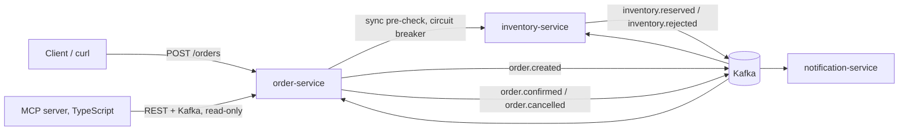

# Event-driven order platform

[](https://github.com/MtyldZ/event-driven-order-platform/actions/workflows/ci.yml)

A small order-processing system built from three Java microservices that cooperate through Kafka (a choreography-based **saga**), plus a TypeScript **MCP server** that lets an AI agent ask "why is this order stuck?" against live data.

It was built as a learning project: every phase came with explanations, real experiments where the system was broken on purpose, and self-check questions. See [docs/learning-notes.md](docs/learning-notes.md).

## Architecture



1. `POST /orders` saves the order as `PENDING` and publishes `order.created`.
2. inventory-service reserves all items (or none) and publishes `inventory.reserved` or `inventory.rejected`.
3. order-service moves the order to `CONFIRMED`, or `CANCELLED` as the compensating action, and publishes `order.confirmed` / `order.cancelled`.
4. notification-service stores and logs a notification.

Details: [architecture](docs/architecture.md) · [event contracts](docs/events.md) · [design decisions](docs/decisions/) · [failure experiments](docs/experiments.md)

## Tech stack

| Layer | Choice |
|---|---|
| Services | Java 21, Spring Boot 4.1, Maven (wrapper) |
| Messaging | Apache Kafka 4.3 (KRaft, no ZooKeeper), Spring for Apache Kafka |
| Data | PostgreSQL 18 (one database per service), Spring Data JPA / Hibernate 7, Flyway |
| Cache | Redis 8 + Spring Cache (cache-aside, evicted after commit) |
| Resilience | Resilience4j (timeouts, retry with backoff, circuit breaker, fallback), dead-letter topics |
| Tests | JUnit 5, Mockito, AssertJ, Awaitility, Testcontainers (real Kafka, Postgres, Redis) |
| MCP server | TypeScript 7, MCP TypeScript SDK v2 (stdio), Zod, `@platformatic/kafka`, Vitest |
| Local run / CI | Docker Compose, GitHub Actions |

## Run it

Requirements: Docker (with Compose) for the system; additionally Java 21 to run the Java tests and Node.js 24 for the MCP server.

```bash
git clone https://github.com/MtyldZ/event-driven-order-platform.git
cd event-driven-order-platform
docker compose up -d --build
```

The first build downloads Maven dependencies inside Docker and takes a few minutes. When `docker compose ps` shows all six containers up (Kafka, Postgres and Redis report `healthy`), the services listen on `localhost:8081` (orders), `8082` (inventory) and `8083` (notifications). Default credentials are for local use only; to change them, copy `.env.example` to `.env` before starting.

Seeded stock: `SKU-1` 100, `SKU-2` 50, `SKU-3` 5, `SKU-4` 0.

## Try it

Place an order (it starts as `PENDING`):

```bash
curl -s -X POST localhost:8081/orders -H 'Content-Type: application/json' -d '{"customerId":"cust-42","items":[{"sku":"SKU-1","quantity":2}]}'
```

A moment later it is `CONFIRMED`. Use the `id` from the response:

```bash
curl -s localhost:8081/orders/<id>/timeline
```

Out-of-stock orders are rejected synchronously by the pre-check (`422`):

```bash
curl -s -X POST localhost:8081/orders -H 'Content-Type: application/json' -d '{"customerId":"cust-42","items":[{"sku":"SKU-4","quantity":1}]}'
```

Invalid input is also a `422`, with the failing fields:

```bash
curl -s -X POST localhost:8081/orders -H 'Content-Type: application/json' -d '{"customerId":"","items":[]}'
```

Stock (served from Redis after the first read) and stuck-order candidates:

```bash
curl -s localhost:8082/stock/SKU-1
```

```bash
curl -s 'localhost:8081/orders?status=PENDING&olderThanMinutes=5'
```

Watch the events flow:

```bash
docker compose logs -f notification-service
```

```bash
docker compose exec kafka /opt/kafka/bin/kafka-console-consumer.sh --bootstrap-server localhost:9092 --topic order.created --from-beginning --formatter-property print.key=true
```

See resilience in action: stop inventory-service, place a few orders (they are accepted as `PENDING` by the circuit-breaker fallback), start it again and watch them become `CONFIRMED`:

```bash
docker compose stop inventory-service
```

```bash
docker compose start inventory-service
```

Stop everything (add `-v` to also delete the database volume):

```bash
docker compose down
```

## MCP server: ask an AI agent about orders

`mcp-server/` exposes four **read-only** tools over stdio:

| Tool | What it does |
|---|---|
| `get_order_status(orderId)` | Current status, customer, items |
| `list_stuck_orders(olderThanMinutes = 5)` | `PENDING` orders older than the threshold |
| `explain_order_timeline(orderId)` | Status history plus a plain-language "where is it and what is missing" |
| `find_order_events(orderId)` | Searches Kafka for the order's events and each service's consumer lag, and says where the saga stopped (e.g. "order.created was never published") |

Build it once:

```bash
cd mcp-server && npm ci && npm run build && cd ..
```

It is already registered for **Claude Code** in [.mcp.json](.mcp.json) (project scope). Start `claude` in the repository root, approve the `order-platform` server when asked, and ask for example *"Are there stuck orders, and why?"*. Run `/mcp` to see its status.

Other MCP clients use the same command (`node mcp-server/dist/index.js`, env `ORDER_SERVICE_URL`, `KAFKA_BROKERS`) in their own config format, e.g. OpenCode: `"mcp": { "order-platform": { "type": "local", "command": ["node", "mcp-server/dist/index.js"] } }` in `opencode.json`.

## Tests

Each service's tests start their own Kafka, Postgres (and Redis) with Testcontainers, so only Docker needs to be running; the Compose stack does not.

```bash
cd services/order-service && ./mvnw verify
```

```bash
cd services/inventory-service && ./mvnw verify
```

```bash
cd services/notification-service && ./mvnw verify
```

```bash
cd mcp-server && npm ci && npm test
```

What they cover: business rules (unit tests), the happy path and the rejection path against real Kafka and Postgres, duplicate events having no second effect, a deterministic optimistic-locking collision, and the MCP tools' input validation and error handling. CI runs all of it on every push and pull request.

## Project structure

```
.
├── docker-compose.yml          Kafka, Postgres, Redis + the three services
├── infra/postgres/init.sql     creates one database per service
├── services/
│   ├── Dockerfile              shared multi-stage build
│   ├── order-service/          orders, saga completion, status history, pre-check client
│   ├── inventory-service/      stock, reservations, Redis cache
│   └── notification-service/   notifications
├── mcp-server/                 TypeScript MCP server (read-only tools)
├── docs/                       architecture, events, experiments, learning notes, ADRs
├── .mcp.json                   Claude Code registration of the MCP server
└── .github/workflows/ci.yml    build + test everything
```

## What I learned

- **At-least-once is real.** Killing a consumer mid-burst caused a redelivery; idempotent consumers (an `eventId` table written in the same transaction as the effect) made it harmless.
- **Ordering is per partition, not per key.** A poison message blocked unrelated orders that happened to share its partition for 8 s.
- **Two writes are not one transaction.** With Kafka down, an order could be saved while its event was lost forever (the dual-write problem); the fix is a transactional outbox.
- **Resilience patterns compose in a specific order.** Retry wraps the circuit breaker; a fallback in the wrong place silently disables retries.
- **JPA details matter:** owning sides, `LAZY` by default, N+1 queries, dirty checking, `save` vs `saveAndFlush`, optimistic locking.
- **Real containers beat mocks** for anything touching Kafka, SQL or transactions.
- **An agent is as powerful as all of its tools.** A read-only MCP server doesn't make the agent read-only; validation and least privilege do the real work.

Full notes with explanations and self-check questions: [docs/learning-notes.md](docs/learning-notes.md).

## License

[MIT](LICENSE)
