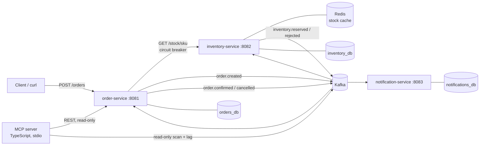
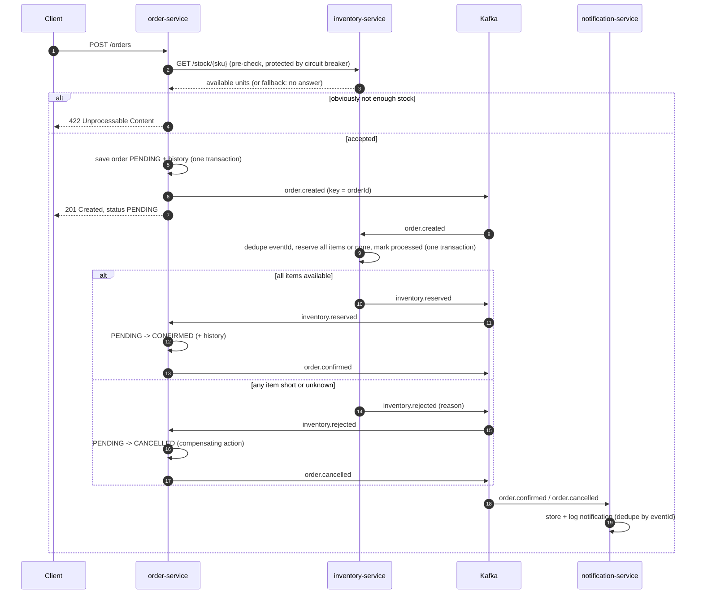

# Architecture

Three Spring Boot services cooperate through Kafka to process an order (a choreography-style saga). A TypeScript MCP server lets an AI agent inspect the system.

## Services and data ownership

| Service | Responsibility | Owns | Talks to |
|---|---|---|---|
| **order-service** | Accepts orders, runs the sync stock pre-check, completes the saga, records status history, exposes status/timeline/stuck-order endpoints | `orders_db`: `orders`, `order_items`, `order_status_history`, `processed_events` | inventory-service (HTTP, pre-check only), Kafka |
| **inventory-service** | Holds stock, reserves it all-or-nothing, serves cached stock reads | `inventory_db`: `stock`, `processed_events`; Redis cache `stock::<sku>` | Kafka, Redis |
| **notification-service** | "Sends" a notification for every final order event (log line + stored row) | `notifications_db`: `notifications` | Kafka |
| **mcp-server** | Read-only tools for an AI agent: status, stuck orders, timeline explanation, Kafka event search | nothing | order-service REST, Kafka (read-only) |

**Database per service.** Each service owns its database; no service reads another's tables. They share data only through events and the one HTTP endpoint. That lets each service change its schema and deploy independently, at the cost of no cross-service joins or transactions, which is why the saga exists ([ADR 0002](decisions/0002-database-per-service.md)). Locally the three databases live in one Postgres container for convenience.

## Order flow (saga, choreography)

- **Eventual consistency:** right after `201` the order is `PENDING`; it typically becomes final within ~50-300 ms. Clients poll `GET /orders/{id}` (or `/timeline`).
- **Choreography:** nobody orchestrates; each service reacts to events. The flow is visible through the per-order timeline and the MCP tools rather than in one place ([ADR 0001](decisions/0001-choreography-saga.md)).

## Synchronous pre-check

Before saving, order-service asks inventory-service for current stock (served from Redis) so impossible orders get an immediate `422` instead of `201` followed by `CANCELLED`. The call has a 500 ms connect / 1 s read timeout, 3 attempts with exponential backoff (200 ms, 400 ms), and a circuit breaker (opens at ≥ 50 % failures over the last 10 calls, minimum 4; 15 s open; 2 trial calls half-open). If inventory can't answer, the **fallback accepts the order as `PENDING`** and the async reservation decides. The pre-check is an optimisation, never a dependency ([ADR 0004](decisions/0004-sync-precheck-with-fallback.md)).

## Failure handling

| Failure | Behaviour |
|---|---|
| Consumer crash / rebalance | Offsets are committed only after processing, so records are redelivered; consumers deduplicate by `eventId` ([ADR 0005](decisions/0005-at-least-once-with-idempotent-consumers.md)) |
| Listener throws | Retry 3× (1 s, 2 s, 4 s), then publish the record unchanged to `<topic>.DLT`; malformed JSON goes to the DLT immediately |
| Two transactions update the same stock row or order | `@Version` optimistic locking: the stale one fails and is retried with fresh data |
| inventory-service down | Breaker opens, orders are accepted as `PENDING`, Kafka holds `order.created` until inventory returns |
| Kafka down while creating an order | **Known gap:** the order may be saved without its event and stay `PENDING` ([ADR 0006](decisions/0006-no-transactional-outbox-yet.md)); `GET /orders?status=PENDING&olderThanMinutes=5` and the MCP tool `find_order_events` detect it |

All of these were reproduced on purpose; results are in [experiments.md](experiments.md).

## REST endpoints

| Service | Endpoint | Notes |
|---|---|---|
| order-service | `POST /orders` | `{ customerId, items: [{ sku, quantity }] }` → `201` + `Location`; validation errors `422`; unparsable JSON `400` |
| order-service | `GET /orders/{id}` | current state |
| order-service | `GET /orders/{id}/timeline` | status history with timestamps and event ids |
| order-service | `GET /orders?status=PENDING&olderThanMinutes=5` | stuck-order candidates |
| inventory-service | `GET /stock/{sku}` | cached in Redis (TTL 10 min, evicted after each reservation commits) |

Errors use RFC 9457 `application/problem+json`.
